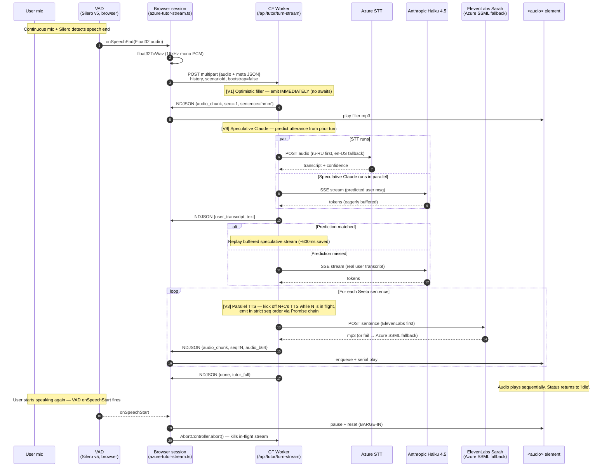
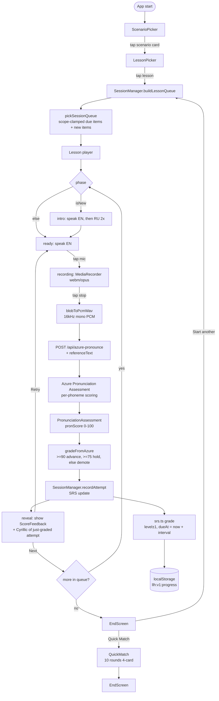

# System Architecture

How the parts fit together. Three pipelines: voice-tutor turn, drill flow with SRS, and build + deploy.

## High-level component map

```mermaid
graph TB
  subgraph Browser
    AppC[App.tsx<br/>screen state machine]
    AppC --> SP[ScenarioPicker]
    AppC --> LP[LessonPicker]
    AppC --> Lesson
    AppC --> QM[QuickMatch]
    AppC --> CP[CustomPhraseEntry]
    AppC --> TS[TutorCallSetup]
    AppC --> TC[TutorCall]

    Lesson --> Recorder[lib/recorder.ts<br/>MediaRecorder]
    Lesson --> TtsSvc[services/tts.ts]
    Lesson --> PronSvc[services/pronunciation.ts]
    Lesson --> Grader[lib/grader.ts<br/>gradeFromAzure]
    Lesson --> SM[lib/session.ts<br/>SessionManager]

    CP --> TransSvc[services/translation.ts]

    TC --> FluidSess[services/azure-tutor-stream.ts<br/>createFluidTutor]
    FluidSess --> VAD[ricky0123/vad-web<br/>Silero VAD]
    FluidSess --> AudioEl[<audio playsInline>]

    SM --> Storage[localStorage<br/>llh:v1:progress]
  end

  subgraph CF_Pages_Worker [Cloudflare Pages Worker]
    APITTS[/api/azure-tts/]
    APIPron[/api/azure-pronounce/]
    APITrans[/api/translate-phrase/]
    APITurn[/api/tutor/turn/]
    APIStream[/api/tutor/turn-stream/]
  end

  TtsSvc -->|live miss| APITTS
  TtsSvc -->|hit| StaticAudio[/audio/{ru,en}/<id>.mp3<br/>edge-cached]
  PronSvc --> APIPron
  TransSvc --> APITrans
  FluidSess --> APIStream

  APITTS --> Azure[Azure Speech REST]
  APIPron --> Azure
  APIStream --> Azure
  APIStream --> Anthropic[Anthropic API<br/>Haiku 4.5]
  APIStream --> Eleven[ElevenLabs API<br/>Sarah multilingual_v2]
  APITrans --> OpenAI[OpenAI gpt-4o-mini]
  APITrans --> Anthropic
```

The browser is the only client. The CF Pages Worker is a thin proxy + orchestrator — every external API call (Azure, Anthropic, ElevenLabs, OpenAI) is server-side so secrets never touch the browser. See [Configuration Guide](configuration-guide.md) for the full env-var list.

## Pipeline 1: Voice tutor turn (streaming)

This is the hot path. Every optimization the project earned (V1, V3, V4, V9) lives here.



### Key observations

- **TTFA = time to first audio chunk** (the user's perceived latency). PROD median = **47ms** because the V1 filler emit happens in the same micro-task as `start()` opens — no awaits in front of it.
- **Total turn time** ≈ STT + Claude streaming + first-sentence TTS + final-sentence TTS. PROD median ~1132ms with V3 parallelism.
- **Sentence boundary detection**: regex `/([^.!?]+[.!?]+)\s*/` against the running token buffer (`turn-stream.ts:143`). Trailing fragments (no terminating punctuation) flushed at stream end.
- **Strict ordering**: each `launchSentence(s, n)` chains onto `emitChain` so seq 0 always sends before seq 1 even if seq 1's TTS finishes first.
- **Filler audio is base64-inlined** into the worker bundle (`src/lib/tutor-fillers.ts`) — same-domain subrequests from CF Worker to a static asset added ~1s on edge cold start, so we eat the 12KB-per-filler bundle bloat instead.

### V9: speculative Claude

`predictUserUtterance(history)` (`turn-stream.ts:356`) parses Sveta's last message for patterns like `Try saying X` or `«X»` (Russian phrase in quotes). When matched, we kick off a Claude stream IN PARALLEL with STT, eagerly buffering tokens. If STT confirms (`transcriptMatches`, ≥70% word overlap), we replay the buffered stream and continue consuming new tokens — saves ~600ms. If STT differs, we abort the speculative stream and start a fresh one.

This works because in the drill loop, when Sveta says "try X", the user almost always says X. The savings only apply on drill-pattern turns; off-script chat misses both predictions and goes through the normal path.

## Pipeline 2: Drill flow with SRS

The drill loop is synchronous from the user's POV: prompt → speak → grade → reveal → next. SRS scheduling threads through it.



### Pimsleur intervals

`PIMSLEUR_INTERVALS_SECONDS` (`src/lib/srs.ts:1`):

| Level | Seconds | Human |
|---|---|---|
| 0 | 5 | "5 seconds" |
| 1 | 25 | 25s |
| 2 | 120 | 2m |
| 3 | 600 | 10m |
| 4 | 3 600 | 1h |
| 5 | 18 000 | 5h ← `MASTERY_LEVEL` |
| 6 | 86 400 | 1 day |
| 7 | 432 000 | 5 days |
| 8 | 2 160 000 | 25 days |

Exact match advances level (next-larger interval). Hold (≥0.9) re-queues at the previous level's interval. Demote (<0.9) drops level by 1 and re-queues in 30s.

### The scope-clamp regression

`pickSessionQueue` (`src/lib/srs.ts:96`) takes `(items, allIds, opts)` and now filters BOTH new and due items by `Set(allIds).has(i.id)`. Before commit `7b5f579`, due-item selection was global — picking a small scenario flooded the queue with globally-due items from every other scenario. The fix is locked in by `srs.test.ts:99`. Don't remove the `allowed` set.

## Pipeline 3: Build + deploy

```mermaid
flowchart LR
  Source[src/<br/>scripts/<br/>public/] --> Prebuild[npm prebuild<br/>copy-vad-assets.mjs]
  Prebuild --> VAD[public/vad/<br/>silero_vad_v5.onnx<br/>vad.worklet.bundle.min.js<br/>ort-wasm-simd-threaded.*]
  Source --> Pregen[npm run audio:pregenerate<br/>NOT in build path]
  Pregen --> StaticAudio[public/audio/<br/>{ru,en}/<id>.mp3]
  Pregen --> Manifest[src/data/audio-manifest.json]

  Source --> Build[npm run build<br/>astro build]
  VAD --> Build
  Build --> Dist[dist/<br/>worker bundle + static assets]

  Dist --> Wrangler[npx wrangler pages deploy dist<br/>--project-name=langhelper<br/>--branch=main<br/>--commit-dirty=true]
  Wrangler --> CF[Cloudflare Pages<br/>account fe61d9ff…]
  CF --> Live[https://langhelper.pages.dev]

  Note1[GitHub push to main does NOT auto-deploy<br/>webhook broken — manual wrangler is the rule]
  Wrangler -.- Note1
```

Build outputs:
- `dist/_worker.js/` — the CF Worker bundle (Astro server output). Includes the `tutor-fillers.ts` base64 mp3s (~12KB × 5).
- `dist/_routes.json` — CF Pages routing manifest (auto-generated).
- `dist/audio/`, `dist/vad/`, `dist/icons/` — static assets, edge-cached.

Secrets are NOT in `dist/` — they live as CF Pages project secrets, accessed at request time via `locals.runtime.env`. See [Configuration Guide](configuration-guide.md).

## Latency optimization history

The voice-tutor turn went from "noticeable lag" to "feels conversational" through a series of autoresearch loops. Each rev was measured with `scripts/autoresearch/measure-tutor-latency-stream.mjs` (median + p90 over N trials).

| Rev | Commit | Win | What changed |
|---|---|---|---|
| baseline | `3eca2f7` | — | Push-to-talk, single Claude call → single TTS call. ~3.5s total. |
| Sonnet→Haiku | `0362ab8` | -38% to -46% TTFA | Model swap to Haiku 4.5 (still streaming). |
| temp 0.7→0.4 | `e5f08ce` | -7% TTFA | Lower temperature reduces token-generation jitter. |
| **V1: optimistic filler** | `ff87498` | TTFA → ~50ms | Emit a pre-rendered "hmm" mp3 as `seq=-1` BEFORE awaiting STT. The user hears Sveta acknowledge before her real reply starts. |
| V1 fix | `b51aa44` | unblocked PROD | Inline filler mp3 base64 into the worker bundle — same-domain subrequests from CF edge added ~1s. |
| **V3: parallel TTS** | `a163765` | -20% real compute | Each sentence's TTS launches the moment its boundary lands; emit chain enforces strict order. Sentence N+1's TTS overlaps with N's emit. |
| **V4: 1-2 sentence prompt** | `38b39ad` | shorter Sveta turns | Prompt rule: "Most replies: ONE sentence. Sometimes two if needed." Reduces total turn duration AND empty-pause anxiety after praise. |
| **V9: speculative Claude** | `110f792` | -600ms when prediction hits | Predict user utterance from Sveta's last turn → kick off Claude in parallel with STT → replay or abort. |
| ElevenLabs Sarah | `158a0ea`, `02b4137` | naturalness, not latency | Multilingual_v2 model handles RU + EN in one call; Starter tier ($6/mo) clears CF Worker datacenter IP block. |

**Current PROD numbers** (May 2026):
- Median TTFA: **47ms** (V1 filler)
- Median total: **1132ms** (full Sveta reply, ~2 sentences)

Re-measure with:
```sh
HARNESS_URL=https://langhelper.pages.dev/api/tutor/turn-stream \
HARNESS_TRIALS=10 \
node scripts/autoresearch/measure-tutor-latency-stream.mjs
```

Quality-gate first (otherwise you might be optimizing a broken pipeline):
```sh
HARNESS_URL=https://langhelper.pages.dev/api/tutor/turn-stream \
node scripts/autoresearch/verify-quality.mjs
```

## Cross-references

- All endpoint shapes documented in [API Reference](api-reference.md).
- Env vars and CF Pages secret setup: [Configuration Guide](configuration-guide.md).
- Test harness for these pipelines: [Testing Guide](testing-guide.md).
